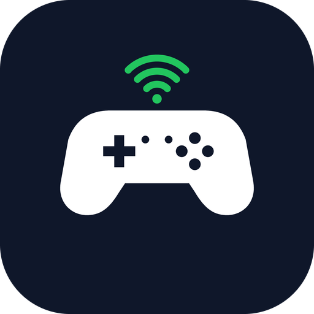

<p align="center">
  
</p>

<h1 align="center">DroidPad</h1>

<p align="center">
  Turn your Android phone into a gamepad — over Wi-Fi (virtual Xbox 360 controller on Windows) or as a standard Bluetooth HID controller.
</p>

<p align="center">
  <a href="README.pt-BR.md">Português</a> · English
</p>

---

## Features

- **Wi-Fi mode** — sends the controller state at 60 Hz over UDP to a small receiver on your PC, which exposes a virtual **Xbox 360 controller** (via ViGEm).
- **Bluetooth HID mode** — the phone shows up as a regular gamepad to any device that supports Bluetooth controllers (no app needed on the other side). Requires Android 9+.
- **Auto-discovery** — finds receivers on your network with a UDP broadcast, or type the IP manually.
- **Fully customizable layout** — drag and resize every block, hide buttons you don't need, and save **profiles per game** (export/import as JSON).
- **Skins** — Xbox, PlayStation and Switch styles.
- **Floating analog areas** — touch anywhere on your half of the screen and the stick starts there.
- **Macros** — 4 hold-to-activate combos (buttons + triggers + stick directions).
- **Haptic feedback**, immersive full-screen mode, and UI in English, Português and Español.

## Requirements

| | |
|---|---|
| **Phone** | Android 8.0+ (API 26). Bluetooth HID mode needs Android 9+. |
| **PC (Wi-Fi mode)** | Windows, Python 3, and the [ViGEmBus](https://github.com/nefarius/ViGEmBus) driver. |
| **Network** | Phone and PC on the same Wi-Fi. Allow UDP ports **9999** (data) and **9998** (discovery) in the Windows firewall. |

## Quick start

### 1. Install the app
Download the latest APK from [**Releases**](../../releases) and install it on your phone (you may need to allow installs from unknown sources), or [build it yourself](#building-the-app).

### 2. Run the PC receiver
```bat
cd pc_receiver
pip install -r requirements.txt
python main.py
```
Or just double-click `pc_receiver\start-server.bat`.

Useful options:

```text
python main.py --print-only      # only prints packets (no driver needed) — good for testing the network
python main.py --port 9999       # change the data port
python main.py --name MyPC       # name shown in discovery
python main.py --no-discovery    # don't answer discovery broadcasts
```

### 3. Connect
Open DroidPad, tap **Find receivers** (or type your PC's IP) and tap **Control (Wi-Fi)**. Open <https://gamepad-tester.com> to check that the virtual controller reacts.

> Without a phone: `python pc_receiver/send_test.py --host 127.0.0.1` sends test packets, and `python pc_receiver/test_gamepad.py` tests the virtual driver alone.

## Building the app

You need JDK 17 and the Android SDK (or just open the `android/` folder in Android Studio).

```bash
cd android
./gradlew assembleDebug        # Windows: gradlew.bat assembleDebug  (or .\build.ps1)
```

The APK is generated at `android/app/build/outputs/apk/debug/app-debug.apk`.

## Project layout

```text
android/        Android app (Kotlin)
pc_receiver/    Windows receiver (Python + vgamepad)
PROTOCOL.md     Network protocol (UDP/JSON, discovery)
docs/           Icon and assets
```

## Protocol

Simple and open: UDP, one JSON packet per datagram, 60 Hz. See [PROTOCOL.md](PROTOCOL.md) if you want to write your own sender or receiver (Linux, macOS, other platforms…).

## Contributing

Issues and pull requests are welcome.
