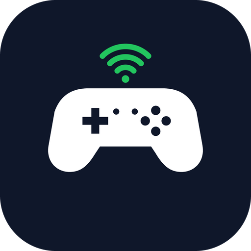

<p align="center">
  
</p>

<h1 align="center">DroidPad</h1>

<p align="center">
  Transforme seu celular Android em um controle de videogame — via Wi-Fi (controle virtual de Xbox 360 no Windows) ou como um controle Bluetooth HID padrão.
</p>

<p align="center">
  Português · <a href="README.md">English</a>
</p>

---

## Recursos

- **Modo Wi-Fi** — envia o estado do controle a 60 Hz por UDP para um receptor no PC, que cria um **controle virtual de Xbox 360** (via ViGEm).
- **Modo Bluetooth HID** — o celular aparece como um gamepad comum para qualquer aparelho que aceite controles Bluetooth (sem precisar de app do outro lado). Requer Android 9+.
- **Descoberta automática** — encontra receptores na rede por broadcast UDP, ou digite o IP manualmente.
- **Layout totalmente personalizável** — arraste e redimensione cada bloco, oculte botões que não usa e salve **perfis por jogo** (exportar/importar em JSON).
- **Skins** — estilos Xbox, PlayStation e Switch.
- **Áreas analógicas flutuantes** — toque em qualquer lugar da sua metade da tela e o analógico começa ali.
- **Macros** — 4 combos ativados ao segurar (botões + gatilhos + direções dos analógicos).
- **Vibração**, modo imersivo em tela cheia e interface em Português, English e Español.

## Requisitos

| | |
|---|---|
| **Celular** | Android 8.0+ (API 26). O modo Bluetooth HID precisa do Android 9+. |
| **PC (modo Wi-Fi)** | Windows, Python 3 e o driver [ViGEmBus](https://github.com/nefarius/ViGEmBus). |
| **Rede** | Celular e PC no mesmo Wi-Fi. Libere as portas UDP **9999** (dados) e **9998** (descoberta) no firewall do Windows. |

## Começando

### 1. Instale o app
Baixe o APK mais recente em [**Releases**](../../releases) e instale no celular (pode ser necessário permitir instalação de fontes desconhecidas), ou [compile você mesmo](#compilando-o-app).

### 2. Rode o receptor no PC
```bat
cd pc_receiver
pip install -r requirements.txt
python main.py
```
Ou dê dois cliques em `pc_receiver\start-server.bat`.

Opções úteis:

```text
python main.py --print-only      # só imprime os pacotes (sem driver) — bom p/ testar a rede
python main.py --port 9999       # muda a porta de dados
python main.py --name MeuPC      # nome mostrado na descoberta
python main.py --no-discovery    # não responde ao broadcast de descoberta
```

### 3. Conecte
Abra o DroidPad, toque em **Buscar receptores** (ou digite o IP do PC) e depois em **Controlar (Wi-Fi)**. Abra <https://gamepad-tester.com> para ver o controle virtual reagindo.

> Sem celular: `python pc_receiver/send_test.py --host 127.0.0.1` envia pacotes de teste, e `python pc_receiver/test_gamepad.py` testa só o driver virtual.

## Compilando o app

Você precisa do JDK 17 e do Android SDK (ou simplesmente abra a pasta `android/` no Android Studio).

```bash
cd android
./gradlew assembleDebug        # Windows: gradlew.bat assembleDebug  (ou .\build.ps1)
```

O APK é gerado em `android/app/build/outputs/apk/debug/app-debug.apk`.

## Estrutura do projeto

```text
android/        App Android (Kotlin)
pc_receiver/    Receptor para Windows (Python + vgamepad)
PROTOCOL.md     Protocolo de rede (UDP/JSON, descoberta)
docs/           Ícone e recursos
```

## Protocolo

Simples e aberto: UDP, um pacote JSON por datagrama, 60 Hz. Veja o [PROTOCOL.md](PROTOCOL.md) se quiser criar seu próprio emissor ou receptor (Linux, macOS, outras plataformas…).

## Contribuindo

Issues e pull requests são bem-vindos.
